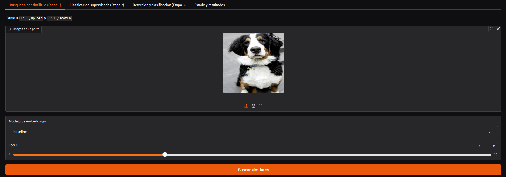
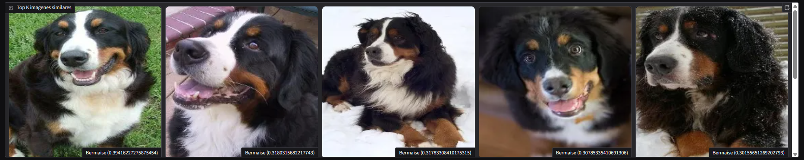
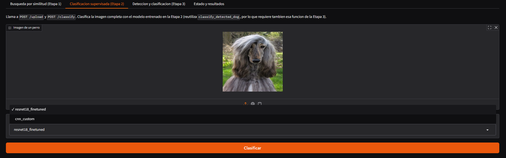
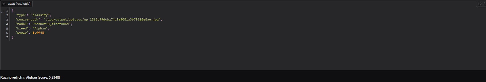
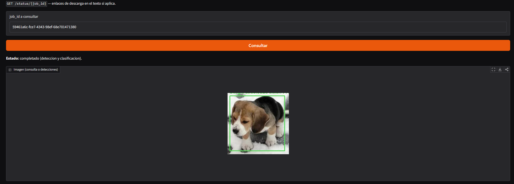
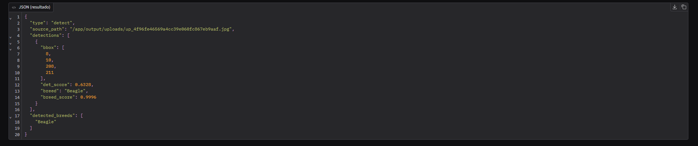

<div align="center">

# Dog Breed Recognition

**An end-to-end Computer Vision pipeline combining image retrieval, supervised classification, and multi-object detection for dog breed recognition.**

[]()
[]()
[]()
[]()
[]()
[]()
[]()

**Idioma:** [English](README.md) | Español

</div>

---

## Overview

Este proyecto implementa un sistema completo de Computer Vision para el reconocimiento de razas de perros a partir de imágenes.

En lugar de depender de un único modelo de clasificación, el proyecto explora e integra tres enfoques diferentes:

1. **Visual similarity search** utilizando deep image embeddings y vector retrieval.
2. **Supervised breed classification** utilizando tanto transfer learning como una custom CNN entrenada desde cero.
3. **Multi-object detection and classification**, combinando YOLOv8 con los clasificadores de razas entrenados.

El proyecto incluye experimentación con modelos, evaluación cuantitativa, análisis de out-of-distribution (OOD) y una arquitectura de aplicación modular construida con FastAPI, Gradio, PostgreSQL/pgvector y Docker.

---

## Key Results

| Área | Mejor resultado |
|---|---|
| Image Retrieval | **NDCG@10: 0.9646** con embeddings de ConvNeXt-Tiny |
| Similarity-based classification | **97.14% validation accuracy** utilizando weighted KNN con K=7 |
| OOD detection | **ROC-AUC: 0.9243** |
| Supervised classification | **97.00% test accuracy / 96.95% F1** con ResNet18 fine-tuned |
| Custom CNN | **83.57% test accuracy / 83.39% F1** entrenada desde cero |
| Image retrieval experiments | **4 backbones × 2 distance metrics evaluadas** |

El proyecto también evalúa el pipeline completo de detection-to-classification y analiza el impacto de las detection failures y el domain shift en el rendimiento end-to-end.

---

## System Architecture

La aplicación soporta tres workflows de Computer Vision independientes pero complementarios:

```text
                              INPUT IMAGE
                                   │
              ┌────────────────────┼────────────────────┐
              │                    │                    │
              ▼                    ▼                    ▼
       IMAGE RETRIEVAL      CLASSIFICATION      DETECTION + CLASSIFICATION
              │                    │                    │
        ConvNeXt-Tiny          ResNet18 /          YOLOv8n
          Embeddings            Custom CNN             │
              │                    │                    ▼
        Vector Search          Softmax            Dog Bounding Boxes
              │                    │                    │
         Weighted KNN       Breed + Confidence    Crop each detection
              │                                         │
              ▼                                         ▼
      Breed or "Unknown"                        Classify each dog
```

---

# Features

## 1. Visual Similarity Search

La primera etapa implementa un sistema de **Content-Based Image Retrieval (CBIR)**.

Cada imagen se transforma en un embedding de alta dimensionalidad utilizando una red neuronal preentrenada. La representación vectorial resultante se utiliza para recuperar imágenes visualmente similares desde una vector database.

La raza predicha se determina mediante weighted voting entre los nearest neighbors.

Un umbral de similitud adicional permite al sistema rechazar imágenes que se encuentran fuera de la distribución conocida y devolver `"unknown"` en lugar de forzar una predicción poco confiable.

### Experimental evaluation

Se evaluaron cuatro pretrained backbones:

- ResNet18
- ResNet50
- EfficientNet-B0
- ConvNeXt-Tiny

Se compararon dos distance metrics:

- Euclidean distance (L2)
- Cosine similarity

La mejor configuración fue **ConvNeXt-Tiny con Euclidean distance**, alcanzando:

- **NDCG@10: 0.9646**
- **97.14% validation accuracy** utilizando weighted voting con **K=7**

El mecanismo de OOD rejection alcanzó un **ROC-AUC de 0.9243**.

### Pipeline

```text
Input Image
    ↓
Extract Embedding
    ↓
Vector Search
    ↓
Top-K Similar Images
    ↓
Weighted Neighbor Voting
    ↓
Breed Prediction or "Unknown"
```

### Application screenshot

<div align="center">
    
    
</div>

---

## 2. Supervised Breed Classification

La segunda etapa se enfoca en la clasificación supervisada directa de **70 dog breeds**.

Se implementaron y evaluaron dos enfoques diferentes:

### Fine-tuned ResNet18

Un modelo ResNet18 pretrained on ImageNet fue adaptado al problema de clasificación de 70 clases.

La capa final de clasificación fue reemplazada y el modelo fue fine-tuned sobre el target dataset.

**Test results:**

| Metric | ResNet18 |
|---|---:|
| Accuracy | **97.00%** |
| Precision (Macro) | 97.16% |
| Recall (Macro) | 97.00% |
| Specificity | 99.96% |
| F1-Score (Macro) | **96.95%** |

### Custom CNN trained from scratch

También se diseñó y entrenó una custom convolutional neural network sin utilizar pretrained weights.

La arquitectura consiste en:

- Four convolutional blocks.
- Batch normalization.
- ReLU activations.
- Max pooling.
- Adaptive average pooling.
- A fully connected classification head with dropout.

El modelo fue entrenado utilizando data augmentation, class weighting, learning-rate scheduling y early stopping.

**Test results:**

| Metric | Custom CNN |
|---|---:|
| Accuracy | **83.57%** |
| Precision (Macro) | 85.20% |
| Recall (Macro) | 83.57% |
| Specificity | 99.76% |
| F1-Score (Macro) | **83.39%** |

La comparación resalta la ventaja de rendimiento del transfer learning y, al mismo tiempo, demuestra la capacidad de diseñar y entrenar una multi-class CNN desde cero.

### Pipeline

```text
Input Image
    ↓
Preprocessing
    ↓
Breed Classifier
    ↓
Softmax Probabilities
    ↓
Predicted Breed + Confidence
```

### Application screenshot

<div align="center">
    
    
</div>

---

## 3. Multi-Object Detection and Breed Classification

La tercera etapa extiende el sistema para manejar escenas más realistas que contienen uno o múltiples perros.

Un detector **YOLOv8n** preentrenado identifica perros en la imagen de entrada. Cada detected bounding box se recorta y se pasa de forma independiente al breed classifier.

Esto separa el problema en dos etapas:

1. **Object localization** — detectar cada perro en la escena.
2. **Breed classification** — asignar una raza a cada instancia detectada.

### Pipeline

```text
Input Image
    ↓
YOLOv8n Dog Detection
    ↓
Bounding Boxes
    ↓
Crop Each Detected Dog
    ↓
Breed Classification
    ↓
Annotated Image + Predictions
```

El pipeline fue evaluado en diferentes escenarios, incluyendo:

- Single-dog images.
- Multiple dogs in the same scene.
- Images without dogs.
- Images containing breeds outside the training distribution.

### End-to-end evaluation

El pipeline integrado también reveló limitaciones importantes.

Cuando se evaluó sobre el test dataset, el rendimiento general del pipeline se vio significativamente afectado por missed detections del modelo genérico YOLOv8n pretrained on COCO.

El análisis identificó dos factores principales:

- **Detection bottleneck:** el detector no identificó perros en una proporción considerable de imágenes, particularmente en close-up y studio-style images.
- **Domain shift:** los clasificadores fueron entrenados con imágenes completas, pero durante la end-to-end inference recibieron crops generados por el detector.

Estos hallazgos proporcionan un camino claro para futuras mejoras, como realizar fine-tuning del detector con domain-specific data y entrenar los clasificadores utilizando cropped dog images.

### Application screenshot

<div align="center">
    
    
</div>

---

# Experimental Approach

El proyecto fue desarrollado como un comparative Computer Vision study en lugar de depender de un único modelo.

Los experimentos incluyen:

- Comparar **four pretrained embedding backbones**.
- Comparar **Euclidean y cosine distance** para image retrieval.
- Evaluar la retrieval quality utilizando **NDCG@10**.
- Optimizar la cantidad de neighbors para weighted KNN classification.
- Evaluar un OOD rejection threshold utilizando **ROC analysis**.
- Comparar **transfer learning con una custom CNN trained from scratch**.
- Utilizar accuracy, macro precision, recall, specificity y macro F1-score.
- Evaluar el pipeline completo de detection-to-classification.
- Investigar las causas de performance degradation en el sistema end-to-end.

El objetivo no fue únicamente obtener una alta model accuracy, sino también comprender cómo se comportan los diferentes componentes cuando se integran en una aplicación completa.

---

# Technologies

### Deep Learning and Computer Vision

- PyTorch
- torchvision
- Ultralytics YOLOv8
- OpenCV

### Machine Learning and Evaluation

- scikit-learn
- NumPy
- pandas

### Visualization

- matplotlib
- seaborn

### Backend and Deployment

- FastAPI
- Uvicorn
- Docker
- Docker Compose

### Vector Storage

- PostgreSQL
- pgvector
- JSON-based embedding storage

### Frontend

- Gradio

---

# Project Structure

El proyecto sigue una arquitectura modular que separa la API, los servicios de Computer Vision, el storage, la evaluación, la configuración y los componentes del frontend.

```text
tuia-dog-recognition-app/
├── src/
│   ├── app/
│   │   └── main.py
│   ├── frontend/
│   │   ├── app.py
│   │   └── gradio_ui.py
│   └── lib/
│       ├── api.py
│       ├── bootstrap.py
│       ├── config.py
│       ├── files.py
│       ├── schemas.py
│       ├── evaluation/
│       │   └── metrics.py
│       ├── visualization/
│       │   └── draw.py
│       ├── services/
│       │   ├── similarity_service.py
│       │   ├── classifier_service.py
│       │   ├── detection_service.py
│       │   └── task_manager.py
│       └── storage/
│           ├── embedding_store.py
│           └── pgvector_store.py
├── scripts/
│   ├── download_dataset.py
│   ├── build_index.py
│   └── train_classifier.py
├── data/
│   ├── dataset/
│   └── embeddings.json
├── models/
├── output/
├── docs/
│   └── screenshots/
├── informe.ipynb
├── etapa1_colab.ipynb
├── etapa2_colab.ipynb
├── etapa3_colab.ipynb
├── Trabajo Práctico N°2.pdf
├── requirements.txt
├── requirements-etapas.txt
├── Dockerfile
├── Dockerfile.frontend
├── docker-compose.yml
├── .dockerignore
├── .gitignore
└── .env.docker.example / .env.local.example
```

El repositorio incluye tanto la aplicación orientada a producción como el trabajo experimental detrás de ella:

- **`src/`** contiene la aplicación modular, API, servicios de Computer Vision, storage y frontend.
- **`scripts/`** incluye utilidades para dataset preparation, vector indexing y model training.
- **`etapa1_colab.ipynb`, `etapa2_colab.ipynb` y `etapa3_colab.ipynb`** documentan los experimentos y la evaluación de cada etapa del pipeline.
- **`models/`** contiene los trained model checkpoints.
- **`docs/`** contiene application screenshots y documentación complementaria.
- La configuración de Docker permite ejecutar el frontend, backend y vector database como servicios separados.

---

# Installation and Usage

## Requirements

- Python 3.12
- Git
- Docker Desktop
- Kaggle account

## Option 1 — Run with Docker

```bash
docker compose build
docker compose up -d
```

Servicios disponibles:

- Frontend: `http://localhost:8080`
- Backend: `http://localhost:8000`
- PostgreSQL: `localhost:5432`

## Option 2 — Local Environment

### 1. Clone the repository

```bash
git clone <repository-url>
cd tuia-dog-recognition-app
```

### 2. Create a Python environment

**Windows**

```bash
python -m venv .venv
.venv\Scripts\Activate.ps1
```

**Linux / macOS**

```bash
python3.12 -m venv .venv
source .venv/bin/activate
```

Alternativamente, utilizando `uv`:

```bash
uv venv --python 3.12 .venv
```

### 3. Install dependencies

```bash
pip install -r requirements.txt
```

O con `uv`:

```bash
uv pip install -r requirements.txt
```

### 4. Configure environment variables

**Linux / macOS**

```bash
cp .env.local.example src/.env
```

**Windows**

```bash
copy .env.local.example src\.env
```

### 5. Download the dataset

```bash
python scripts/download_dataset.py
```

Esto requiere credenciales de la Kaggle API.

Alternativamente, podés descargar el dataset manualmente y colocar los directorios `train/`, `valid/` y `test/` dentro de `data/dataset`.

### 6. Start the vector database

Requerido cuando `USE_PGVECTOR=true`:

```bash
docker compose up postgres -d
```

Cuando `USE_PGVECTOR=false`, la aplicación utiliza el local JSON embedding store.

### 7. Add trained model checkpoints

Colocá los trained checkpoints dentro de `models/`.

Configurá las rutas correspondientes mediante:

```text
RESNET18_MODEL_NAME
CNN_CUSTOM_MODEL_NAME
```

La aplicación soporta modelos `.pth` y `.onnx`.

### 8. Build the vector index

```bash
python scripts/build_index.py --split train
```

### 9. Start the backend

```bash
cd src
uvicorn app.main:app --reload --port 8000
```

### 10. Start the frontend

En otra terminal:

```bash
cd src
uvicorn frontend.app:app --port 8080
```

### 11. Verify the application

- Frontend: `http://localhost:8080`
- Backend health check: `http://localhost:8000/health`

---

# API Endpoints

| Endpoint | Descripción |
|---|---|
| `POST /upload` | Subir una imagen |
| `POST /search` | Buscar imágenes visualmente similares |
| `POST /classify` | Clasificar una raza de perro |
| `POST /detect` | Detectar y clasificar uno o varios perros |
| `GET /status/{job_id}` | Consultar el estado de una tarea asíncrona |
| `GET /models` | Listar los embedding models disponibles |
| `GET /health` | Verificar el backend status |

Los asynchronous endpoints (`/search` y `/detect`) devuelven `HTTP 202` con un `job_id`.

```json
{
  "status": "done | inProgress | failed",
  "link": "url | none"
}
```

---

# Useful Scripts

```bash
# Descargar el dataset
python scripts/download_dataset.py

# Construir el vector index
python scripts/build_index.py --split train

# Entrenar y evaluar un clasificador
python scripts/train_classifier.py --model resnet18_finetuned
```

---

# Configuration

La configuración de la aplicación se gestiona mediante environment variables.

Los parámetros principales incluyen:

- `EMBEDDING_MODEL`: embedding model utilizado para similarity search.
- `SIMILARITY_THRESHOLD`: threshold para OOD rejection.
- `TOP_K`: cantidad de nearest neighbors.
- `USE_PGVECTOR`: permite alternar entre PostgreSQL/pgvector y local JSON storage.
- `EMBEDDING_DIM`: embedding dimensionality.
- `RESNET18_MODEL_NAME`: path al ResNet18 checkpoint.
- `CNN_CUSTOM_MODEL_NAME`: path al custom CNN checkpoint.

Al cambiar el embedding model, el vector index debe reconstruirse.

---

# Future Improvements

La evaluación end-to-end identificó varias oportunidades para continuar desarrollando el sistema:

- Realizar fine-tuning del object detector con dog-specific bounding box data.
- Entrenar los breed classifiers utilizando detector-style crops para reducir el domain shift.
- Evaluar el sistema con datasets más diversos y representativos de escenarios reales.
- Optimizar la inferencia utilizando ONNX Runtime o TensorRT para un deployment orientado a producción.

Estas mejoras se basan en las limitaciones identificadas durante la evaluación end-to-end y no son necesarias para que el sistema actual funcione.

---

# Project Scope

Este proyecto demuestra experiencia en:

- Computer Vision pipelines.
- Deep Learning con PyTorch.
- Transfer learning y fine-tuning.
- Diseño y entrenamiento de custom CNN architectures.
- Image embeddings y vector similarity search.
- Object detection con YOLO.
- Out-of-distribution analysis.
- Model comparison y quantitative evaluation.
- Desarrollo de REST APIs con FastAPI.
- Vector databases con pgvector.
- Containerized applications con Docker.

---

## Documentation

El repositorio incluye detailed experimental notebooks y documentación técnica sobre model training, evaluation, metrics e implementation decisions.

Parte de la documentación técnica extendida se encuentra actualmente disponible en **español**, mientras que el README principal proporciona un overview en inglés de la arquitectura, los experimentos y los principales resultados.

<div align="center">

**Computer Vision · Deep Learning · Image Retrieval · Object Detection**

</div>