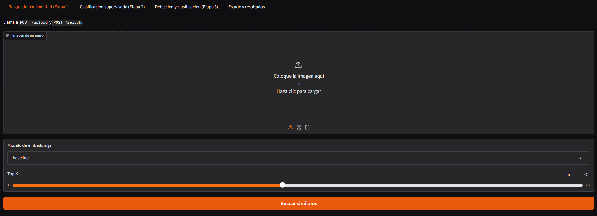
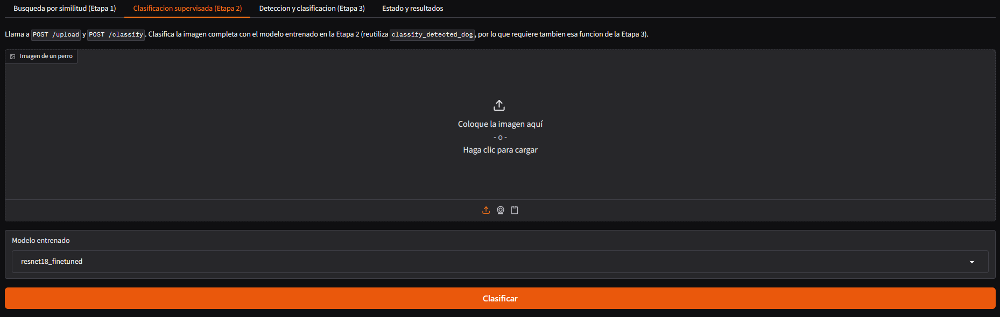
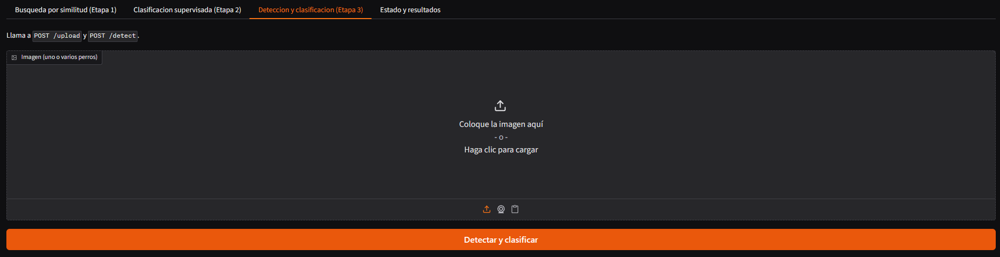

<div align="center">

# Dog Breed Recognition

**An end-to-end Computer Vision pipeline combining image retrieval, supervised classification, and multi-object detection for dog breed recognition.**

[]()
[]()
[]()
[]()
[]()
[]()
[]()

</div>

---

## Overview

This project implements a complete Computer Vision system for recognizing dog breeds from images.

Rather than relying on a single classification model, the project explores and integrates three different approaches:

1. **Visual similarity search** using deep image embeddings and vector retrieval.
2. **Supervised breed classification** using both transfer learning and a custom CNN trained from scratch.
3. **Multi-object detection and classification**, combining YOLOv8 with the trained breed classifiers.

The project includes model experimentation, quantitative evaluation, out-of-distribution analysis, and a modular application architecture built with FastAPI, Gradio, PostgreSQL/pgvector, and Docker.

---

## Key Results

| Area | Best Result |
|---|---|
| Image Retrieval | **NDCG@10: 0.9646** with ConvNeXt-Tiny embeddings |
| Similarity-based classification | **97.14% validation accuracy** using weighted KNN with K=7 |
| OOD detection | **ROC-AUC: 0.9243** |
| Supervised classification | **97.00% test accuracy / 96.95% F1** with fine-tuned ResNet18 |
| Custom CNN | **83.57% test accuracy / 83.39% F1** trained from scratch |
| Image retrieval experiments | **4 backbones × 2 distance metrics evaluated** |

The project also evaluates the complete detection-to-classification pipeline and analyzes the impact of detection failures and domain shift on end-to-end performance.

---

## System Architecture

The application supports three independent but complementary Computer Vision workflows:

```text
                              INPUT IMAGE
                                   │
              ┌────────────────────┼────────────────────┐
              │                    │                    │
              ▼                    ▼                    ▼
       IMAGE RETRIEVAL      CLASSIFICATION      DETECTION + CLASSIFICATION
              │                    │                    │
        ConvNeXt-Tiny          ResNet18 /          YOLOv8n
          Embeddings            Custom CNN             │
              │                    │                    ▼
        Vector Search          Softmax            Dog Bounding Boxes
              │                    │                    │
         Weighted KNN       Breed + Confidence    Crop each detection
              │                                         │
              ▼                                         ▼
      Breed or "Unknown"                        Classify each dog
```

---

# Features

## 1. Visual Similarity Search

The first stage implements a **Content-Based Image Retrieval (CBIR)** system.

Each image is transformed into a high-dimensional embedding using a pretrained neural network. The resulting vector representation is used to retrieve visually similar images from a vector database.

The predicted breed is determined through weighted voting among the nearest neighbors.

An additional similarity threshold allows the system to reject images that are outside the known distribution and return `"unknown"` instead of forcing an unreliable prediction.

### Experimental evaluation

Four pretrained backbones were evaluated:

- ResNet18
- ResNet50
- EfficientNet-B0
- ConvNeXt-Tiny

Two distance metrics were compared:

- Euclidean distance (L2)
- Cosine similarity

The best configuration was **ConvNeXt-Tiny with Euclidean distance**, achieving:

- **NDCG@10: 0.9646**
- **97.14% validation accuracy** using weighted voting with **K=7**

The OOD rejection mechanism achieved a **ROC-AUC of 0.9243**.

### Pipeline

```text
Input Image
    ↓
Extract Embedding
    ↓
Vector Search
    ↓
Top-K Similar Images
    ↓
Weighted Neighbor Voting
    ↓
Breed Prediction or "Unknown"
```

### Application screenshot

<div align="center">
  
</div>

---

## 2. Supervised Breed Classification

The second stage focuses on direct supervised classification of **70 dog breeds**.

Two different approaches were implemented and evaluated:

### Fine-tuned ResNet18

A ResNet18 model pretrained on ImageNet was adapted for the 70-class classification problem.

The final classification layer was replaced and the model was fine-tuned on the target dataset.

**Test results:**

| Metric | ResNet18 |
|---|---:|
| Accuracy | **97.00%** |
| Precision (Macro) | 97.16% |
| Recall (Macro) | 97.00% |
| Specificity | 99.96% |
| F1-Score (Macro) | **96.95%** |

### Custom CNN trained from scratch

A custom convolutional neural network was also designed and trained without pretrained weights.

The architecture consists of:

- Four convolutional blocks.
- Batch normalization.
- ReLU activations.
- Max pooling.
- Adaptive average pooling.
- A fully connected classification head with dropout.

The model was trained using data augmentation, class weighting, learning-rate scheduling, and early stopping.

**Test results:**

| Metric | Custom CNN |
|---|---:|
| Accuracy | **83.57%** |
| Precision (Macro) | 85.20% |
| Recall (Macro) | 83.57% |
| Specificity | 99.76% |
| F1-Score (Macro) | **83.39%** |

The comparison highlights the performance advantage of transfer learning while also demonstrating the ability to design and train a multi-class CNN from scratch.

### Pipeline

```text
Input Image
    ↓
Preprocessing
    ↓
Breed Classifier
    ↓
Softmax Probabilities
    ↓
Predicted Breed + Confidence
```

### Application screenshot

<div align="center">
  
</div>

---

## 3. Multi-Object Detection and Breed Classification

The third stage extends the system to handle more realistic scenes containing one or multiple dogs.

A pretrained **YOLOv8n** detector identifies dogs in the input image. Each detected bounding box is cropped and passed independently to the breed classifier.

This separates the problem into two stages:

1. **Object localization** — detecting each dog in the scene.
2. **Breed classification** — assigning a breed to each detected instance.

### Pipeline

```text
Input Image
    ↓
YOLOv8n Dog Detection
    ↓
Bounding Boxes
    ↓
Crop Each Detected Dog
    ↓
Breed Classification
    ↓
Annotated Image + Predictions
```

The pipeline was evaluated in different scenarios, including:

- Single-dog images.
- Multiple dogs in the same scene.
- Images without dogs.
- Images containing breeds outside the training distribution.

### End-to-end evaluation

The integrated pipeline also revealed important limitations.

When evaluated on the test dataset, the overall pipeline performance was significantly affected by missed detections from the generic COCO-pretrained YOLOv8n model.

The analysis identified two main factors:

- **Detection bottleneck:** the detector missed dogs in a substantial portion of images, particularly in close-up and studio-style images.
- **Domain shift:** classifiers were trained on complete images but received detector-generated crops during end-to-end inference.

These findings provide a clear path for future improvements, such as fine-tuning the detector on domain-specific data and training classifiers on cropped dog images.

### Application screenshot

<div align="center">
  
</div>

---

# Experimental Approach

The project was developed as a comparative Computer Vision study rather than relying on a single model.

The experiments include:

- Comparing **four pretrained embedding backbones**.
- Comparing **Euclidean and cosine distance** for image retrieval.
- Evaluating retrieval quality using **NDCG@10**.
- Optimizing the number of neighbors for weighted KNN classification.
- Evaluating an OOD rejection threshold using **ROC analysis**.
- Comparing **transfer learning against a custom CNN trained from scratch**.
- Using accuracy, macro precision, recall, specificity, and macro F1-score.
- Evaluating the complete detection-to-classification pipeline.
- Investigating the causes of performance degradation in the end-to-end system.

The goal was not only to obtain high model accuracy, but also to understand how the different components behave when integrated into a complete application.

---

# Technologies

### Deep Learning and Computer Vision

- PyTorch
- torchvision
- Ultralytics YOLOv8
- OpenCV

### Machine Learning and Evaluation

- scikit-learn
- NumPy
- pandas

### Visualization

- matplotlib
- seaborn

### Backend and Deployment

- FastAPI
- Uvicorn
- Docker
- Docker Compose

### Vector Storage

- PostgreSQL
- pgvector
- JSON-based embedding storage

### Frontend

- Gradio

---

# Project Structure

The project follows a modular architecture that separates the API, Computer Vision services, storage, evaluation, configuration, and frontend components.

```text
tuia-dog-recognition-app/
├── src/
│   ├── app/
│   │   └── main.py
│   ├── frontend/
│   │   ├── app.py
│   │   └── gradio_ui.py
│   └── lib/
│       ├── api.py
│       ├── bootstrap.py
│       ├── config.py
│       ├── files.py
│       ├── schemas.py
│       ├── evaluation/
│       │   └── metrics.py
│       ├── visualization/
│       │   └── draw.py
│       ├── services/
│       │   ├── similarity_service.py
│       │   ├── classifier_service.py
│       │   ├── detection_service.py
│       │   └── task_manager.py
│       └── storage/
│           ├── embedding_store.py
│           └── pgvector_store.py
├── scripts/
│   ├── download_dataset.py
│   ├── build_index.py
│   └── train_classifier.py
├── data/
│   ├── dataset/
│   └── embeddings.json
├── models/
├── output/
├── docs/
│   └── screenshots/
├── informe.ipynb
├── etapa1_colab.ipynb
├── etapa2_colab.ipynb
├── etapa3_colab.ipynb
├── Trabajo Práctico N°2.pdf
├── requirements.txt
├── requirements-etapas.txt
├── Dockerfile
├── Dockerfile.frontend
├── docker-compose.yml
├── .dockerignore
├── .gitignore
└── .env.docker.example / .env.local.example
```

The repository includes both the production-oriented application and the experimental work behind it:

- **`src/`** contains the modular application, API, Computer Vision services, storage, and frontend.
- **`scripts/`** includes utilities for dataset preparation, vector indexing, and model training.
- **`etapa1_colab.ipynb`, `etapa2_colab.ipynb`, and `etapa3_colab.ipynb`** document the experiments and evaluation for each stage of the pipeline.
- **`models/`** contains the trained model checkpoints.
- **`docs/`** contains application screenshots and supporting documentation.
- Docker configuration allows the frontend, backend, and vector database to run as separate services.

---

# Installation and Usage

## Requirements

- Python 3.12
- Git
- Docker Desktop
- Kaggle account

## Option 1 — Run with Docker

```bash
docker compose build
docker compose up -d
```

Available services:

- Frontend: `http://localhost:8080`
- Backend: `http://localhost:8000`
- PostgreSQL: `localhost:5432`

## Option 2 — Local Environment

### 1. Clone the repository

```bash
git clone <repository-url>
cd tuia-dog-recognition-app
```

### 2. Create a Python environment

**Windows**

```bash
python -m venv .venv
.venv\Scripts\Activate.ps1
```

**Linux / macOS**

```bash
python3.12 -m venv .venv
source .venv/bin/activate
```

Alternatively, using `uv`:

```bash
uv venv --python 3.12 .venv
```

### 3. Install dependencies

```bash
pip install -r requirements.txt
```

Or with `uv`:

```bash
uv pip install -r requirements.txt
```

### 4. Configure environment variables

**Linux / macOS**

```bash
cp .env.local.example src/.env
```

**Windows**

```bash
copy .env.local.example src\.env
```

### 5. Download the dataset

```bash
python scripts/download_dataset.py
```

This requires Kaggle API credentials.

Alternatively, download the dataset manually and place the `train/`, `valid/`, and `test/` directories inside `data/dataset`.

### 6. Start the vector database

Required when `USE_PGVECTOR=true`:

```bash
docker compose up postgres -d
```

When `USE_PGVECTOR=false`, the application uses the local JSON embedding store.

### 7. Add trained model checkpoints

Place the trained checkpoints inside `models/`.

Configure the corresponding paths through:

```text
RESNET18_MODEL_NAME
CNN_CUSTOM_MODEL_NAME
```

The application supports both `.pth` and `.onnx` models.

### 8. Build the vector index

```bash
python scripts/build_index.py --split train
```

### 9. Start the backend

```bash
cd src
uvicorn app.main:app --reload --port 8000
```

### 10. Start the frontend

In another terminal:

```bash
cd src
uvicorn frontend.app:app --port 8080
```

### 11. Verify the application

- Frontend: `http://localhost:8080`
- Backend health check: `http://localhost:8000/health`

---

# API Endpoints

| Endpoint | Description |
|---|---|
| `POST /upload` | Upload an image |
| `POST /search` | Search visually similar images |
| `POST /classify` | Classify a dog breed |
| `POST /detect` | Detect and classify one or more dogs |
| `GET /status/{job_id}` | Check asynchronous job status |
| `GET /models` | List available embedding models |
| `GET /health` | Check backend status |

The asynchronous endpoints (`/search` and `/detect`) return `HTTP 202` with a `job_id`.

```json
{
  "status": "done | inProgress | failed",
  "link": "url | none"
}
```

---

# Useful Scripts

```bash
# Download the dataset
python scripts/download_dataset.py

# Build the vector index
python scripts/build_index.py --split train

# Train and evaluate a classifier
python scripts/train_classifier.py --model resnet18_finetuned
```

---

# Configuration

Application configuration is managed through environment variables.

Key parameters include:

- `EMBEDDING_MODEL`: embedding model used for similarity search.
- `SIMILARITY_THRESHOLD`: threshold for OOD rejection.
- `TOP_K`: number of nearest neighbors.
- `USE_PGVECTOR`: switch between PostgreSQL/pgvector and local JSON storage.
- `EMBEDDING_DIM`: embedding dimensionality.
- `RESNET18_MODEL_NAME`: path to the ResNet18 checkpoint.
- `CNN_CUSTOM_MODEL_NAME`: path to the custom CNN checkpoint.

When changing the embedding model, the vector index must be rebuilt.

---

# Future Improvements

The end-to-end evaluation identified several opportunities for further development:

- Fine-tune the object detector on dog-specific bounding box data.
- Train breed classifiers using detector-style crops to reduce domain shift.
- Evaluate the system on more diverse real-world datasets.
- Optimize inference using ONNX Runtime or TensorRT for production-oriented deployment.

These improvements are based on limitations identified during the end-to-end evaluation and are not required for the current system to operate.

---

# Project Scope

This project demonstrates experience with:

- Computer Vision pipelines.
- Deep Learning with PyTorch.
- Transfer learning and fine-tuning.
- Custom CNN architecture design and training.
- Image embeddings and vector similarity search.
- Object detection with YOLO.
- Out-of-distribution analysis.
- Model comparison and quantitative evaluation.
- REST API development with FastAPI.
- Vector databases with pgvector.
- Containerized applications with Docker.

---

## Documentation

The repository includes detailed experimental notebooks and technical documentation covering model training, evaluation, metrics, and implementation decisions.

Some of the extended technical documentation is currently available in **Spanish**, while this README provides an English overview of the project's architecture, experiments, and main results.

<div align="center">

**Computer Vision · Deep Learning · Image Retrieval · Object Detection**

</div>